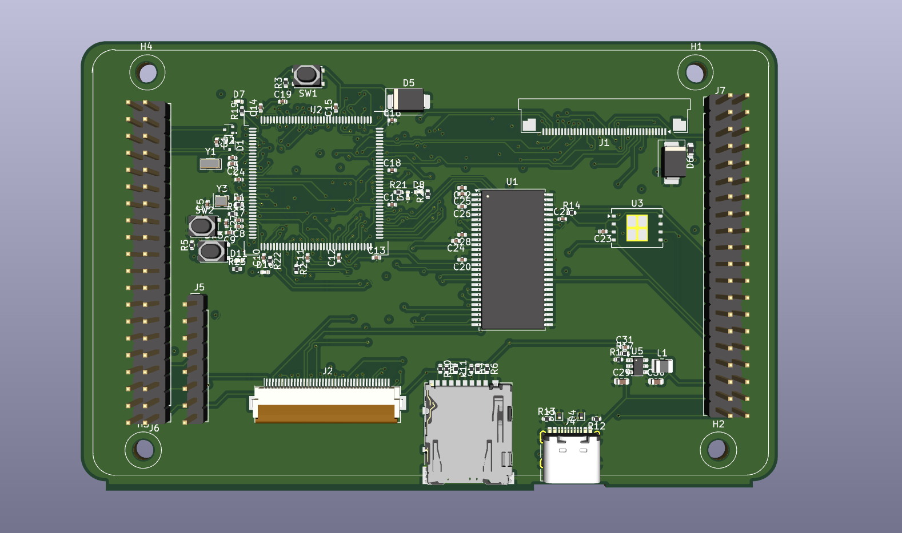
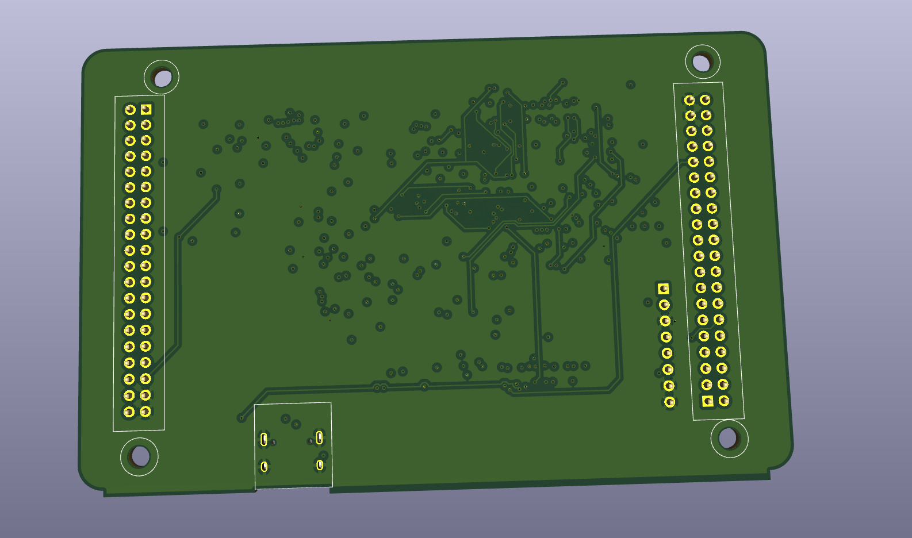
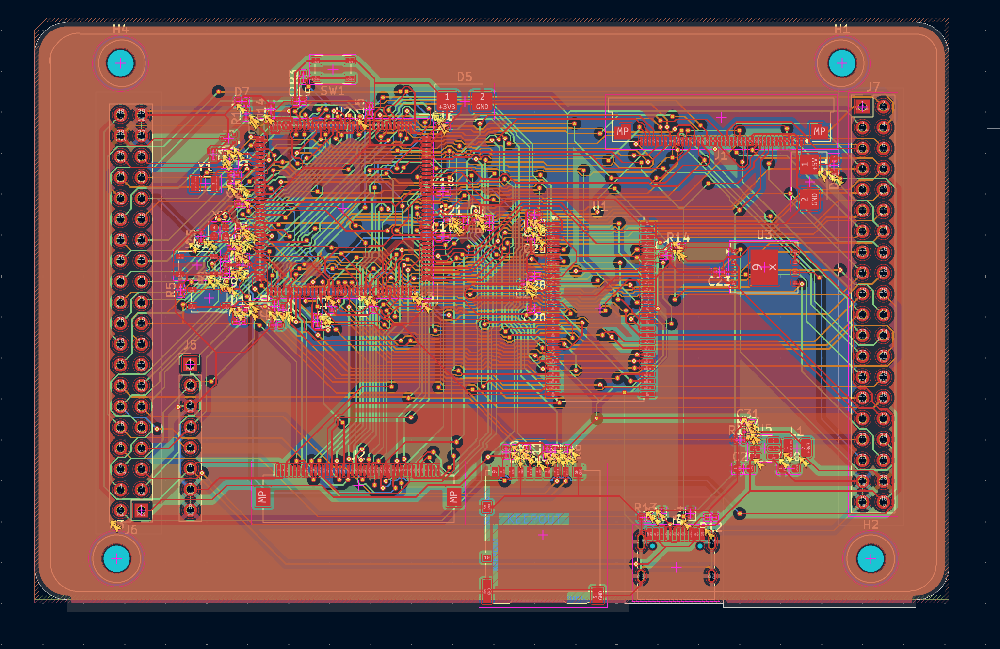
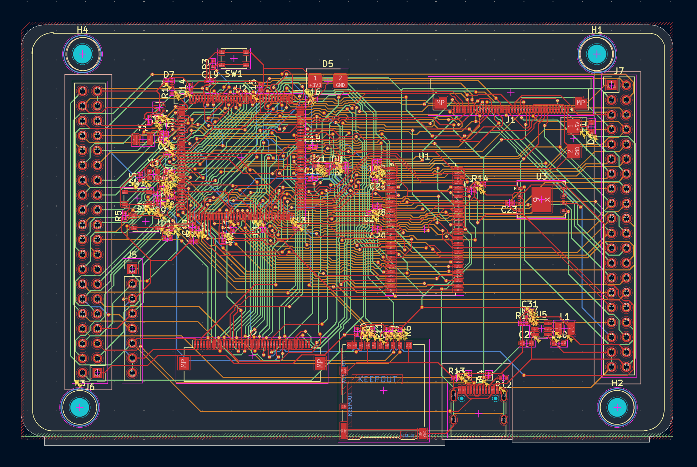
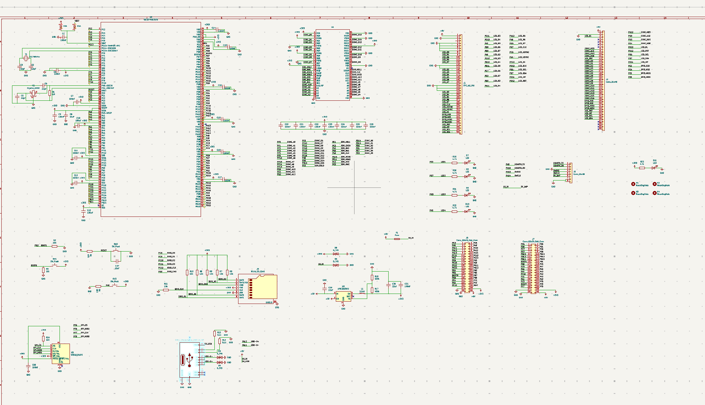

# GD32F450 Custom Dev Board

Custom development board using the GD32F450ZGT6 ARM Cortex-M4 microcontroller.

Designed to provide a custom hardware platform that includes the microcontroller, external memory, storage, power management and expansion.

External SDRAM, W25Q128JVE SPI flash, microSD card, USB-C, FPC connections, and GPIO expansion are available.

This repo contains the hardware design files, KiCad project, PCB layout, manufacture Gerber files, components BOM and 3D model.

## Why This Project?

To understand more than just development boards and how to make one.

I had chosen to actually design a complete development board around the GD32F450ZGT6. This involved going through the whole design process for the hardware, including schematic design, component selection, PCB layout, 4-layer routing, and manufacturing file design.

This would allow me to design a flexible development platform and gain practical knowledge of embedded hardware design, memory inclusion, power management, PCB design, and hardware manufacturing.

Most importantly it allowed me to take a microcontroller data sheet and an idea and produce a complete PCB that can be manufactured.

## Inspiration

The inspiration for my project was to create a development board that combines the flexibility of a general purpose microcontroller with an advanced embedded system.

This would allow me to experiment with adding external memory and storage along with multiple expansion ports to my microcontroller.

I wanted to keep the design simple so that I had a useful board to experiment, learn and use for future embedded projects.

All components were selected to help me understand how each hardware block interacts together.

## Hardware

The board contains several hardware components that work together to form an embedded development platform.

| Feature | Description |
|---|---|
| **Microcontroller** | GD32F450ZGT6 ARM Cortex-M4 |
| **External SDRAM** | TSOP-II-54 SDRAM interface |
| **SPI Flash** | W25Q128JVE 128-Mbit serial flash |
| **Power Management** | AP63203WU buck regulator |
| **USB Connectivity** | USB Type-C receptacle |
| **Removable Storage** | microSD card interface |
| **FPC Interfaces** | Two 40-pin, 0.5 mm-pitch connectors |
| **Expansion Headers** | Two 40-pin headers and one 8-pin header |
| **PCB Stackup** | Four-layer PCB with dedicated internal power and ground planes |

The board also includes supporting circuitry for clock generation, reset, power filtering and user interaction.

External memory, removable storage and expansion interfaces provide flexibility for a range of embedded development experiments.

## Project Images

### 3D PCB Design

The PCB was designed and visualized in KiCad's 3D Viewer to inspect component placement, board layout, and both sides of the design.

**Front View**

**Back View**

### PCB Layout and Routing

**PCB Routing**

**PCB Routing Without Copper Fill**

### Circuit Schematic

The schematic shows the electrical design and the connections between the microcontroller, memory, power circuitry, and peripheral interfaces.

## Bill of Materials (BOM)

The complete component-level BOM is available in [`bom.csv`](bom.csv). 

| Component Name | Quantity | Price (USD) | Purchase Link |
|---|---:|---:|---|
| 100nF Capacitor | 23 | $0.1058 | [LCSC](https://www.lcsc.com/product-detail/C1525.html) |
| 10pF Capacitor | 2 | $0.0104 | [LCSC](https://www.lcsc.com/product-detail/C3860506.html) |
| 22pF Capacitor | 2 | $0.0086 | [LCSC](https://www.lcsc.com/product-detail/C1555.html) |
| 10uF Capacitor | 2 | $0.0270 | [LCSC](https://www.lcsc.com/product-detail/C163694.html) |
| 22uF Capacitor | 2 | $0.1144 | [LCSC](https://www.lcsc.com/product-detail/C109448.html) |
| Dual Schottky Diode | 2 | $0.0370 | [LCSC](https://www.lcsc.com/product-detail/C545547.html) |
| TVS Diode | 2 | $0.0324 | [LCSC](https://www.lcsc.com/product-detail/C266458.html) |
| 5V TVS Diode | 2 | $0.0824 | [LCSC](https://www.lcsc.com/product-detail/C260407.html) |
| Green LED | 5 | $0.0730 | [LCSC](https://www.lcsc.com/product-detail/C20608784.html) |
| Resettable Fuse | 1 | $0.0458 | [LCSC](https://www.lcsc.com/product-detail/C210357.html) |
| 40-pin FPC Connector | 1 | $0.1940 | [LCSC](https://www.lcsc.com/product-detail/C7419877.html) |
| 40-pin FPC Connector | 1 | $0.3856 | [LCSC](https://www.lcsc.com/product-detail/C202114.html) |
| microSD Card Connector | 1 | $1.7896 | [LCSC](https://www.lcsc.com/product-detail/C114218.html) |
| USB-C Receptacle | 1 | $0.1724 | [LCSC](https://www.lcsc.com/product-detail/C165948.html) |
| 8-pin Header | 1 | $0.0320 | [LCSC](https://www.lcsc.com/product-detail/C5156616.html) |
| 40-pin Dual-row Header | 2 | $0.4286 | [LCSC](https://www.lcsc.com/product-detail/C50980.html) |
| 2.2uH Inductor | 1 | $0.1495 | [LCSC](https://www.lcsc.com/product-detail/C576403.html) |
| 1MΩ Resistor | 1 | $0.0026 | [LCSC](https://www.lcsc.com/product-detail/C26083.html) |
| 10kΩ Resistor | 11 | $0.0341 | [LCSC](https://www.lcsc.com/product-detail/C25744.html) |
| 5.1kΩ Resistor | 2 | $0.0052 | [LCSC](https://www.lcsc.com/product-detail/C25905.html) |
| 450kΩ Resistor | 1 | $0.0026 | [LCSC](https://www.lcsc.com/product-detail/C25883.html) |
| 100kΩ Resistor | 1 | $0.0013 | [LCSC](https://www.lcsc.com/product-detail/C25741.html) |
| 4.7kΩ Resistor | 5 | $0.0145 | [LCSC](https://www.lcsc.com/product-detail/C25900.html) |
| Tactile Push-button Switch | 3 | $1.7496 | [LCSC](https://www.lcsc.com/product-detail/C116501.html) |
| 256Mbit SDRAM | 1 | $6.1612 | [LCSC](https://www.lcsc.com/product-detail/C62246.html) |
| GD32F450ZGT6 Microcontroller | 1 | $7.2594 | [LCSC](https://www.lcsc.com/product-detail/C99163.html) |
| W25Q128JVE SPI Flash | 1 | $3.8086 | [LCSC](https://www.lcsc.com/product-detail/C2456297.html) |
| AP63203WU Buck Regulator | 1 | $0.7925 | [LCSC](https://www.lcsc.com/product-detail/C780769.html) |
| 32.768kHz Crystal | 1 | $0.1329 | [LCSC](https://www.lcsc.com/product-detail/C271654.html) |
| 25MHz Crystal | 1 | $0.0936 | [LCSC](https://www.lcsc.com/product-detail/C7301943.html) |
| **Component Subtotal** | | **$23.7466** | |
| PCB Fabrication – JLCPCB (4-layer) | 1 | $30.00 | [JLCPCB](https://jlcpcb.com/) |
| **Grand Total** | | **$53.7466** | |

### Firmware Flashing

The firmware is written in C using the GD32F4xx Standard Peripheral Library. To build it, install the ARM GNU Toolchain and add the required GD32F4xx library, startup files and linker script. Once compiled, generate a firmware image and flash it to the GD32F450ZGT6 using an SWD programmer such as a J-Link or CMSIS-DAP debugger. After flashing, connect to USART0 through PA9 (TX) and PA10 (RX) using a serial terminal configured for 115200 baud, 8-N-1. The initial firmware provides basic MCU information, an internal SRAM test, uptime reporting and a serial command interface. External SDRAM, SPI flash, microSD and USB drivers are not yet implemented.

## Manufacturing

We have now designed our PCB and can produce our manufacturing files from KiCad.

The gerber/ folder contains all the Gerber and drill files needed to manufacture a PCB. This has also been zipped together to make it easier to upload.

These files are:

Copper Layers: Front, Back, In1, In2

Solder Mask: Front, Back

Paste Layers: Front, Back

Silkscreen: Front, Back

Board Outline: Edge.Cuts

Drills: Plated (PTH), Non-Plated (NPTH)

Gerber File:

Layer and Fabrication Information

## PCB Manufacture

Our board has been designed as a 4 layer PCB. We can manufacture our board using [JLCPCB](https://jlcpcb.com/).

The cost of manufacturing our PCB is estimated to be $30 USD.

To manufacture our board we need to upload our gerber.zip file to the Gerber viewer on the PCB manufacturers website. Check the layers and board outline are detected correctly and the settings for manufacture are correct before ordering.
